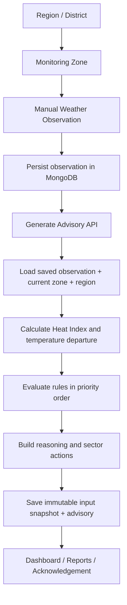

# Heatwave Alert & Advisory Portal

**Academic use case:** KJS-CES-01 — Climate Intelligence for Heatwave Monitoring, Prediction and Early Warning  
**Institute:** K J Somaiya School of Engineering · Full Stack Development Laboratory (Java) · AY 2026–27  
**Application vertical:** Climate, Energy & Sustainability

A full-stack academic prototype for managing regions and heat-vulnerable monitoring zones, recording manually entered meteorological observations, and generating explainable heatwave alerts and civic advisories.

> **Important:** This is an academic decision-support prototype. It is not an official warning service and is not a substitute for India Meteorological Department (IMD) bulletins or instructions from disaster-management and public-health authorities. Its thresholds and derived heat index are demonstration parameters that require validation before any real-world use.

---

## 1. What is implemented

- Dashboard with counts derived from MongoDB, recent observations/advisories, latest zone status, pending acknowledgements and a severity chart.
- Region / district authority CRUD with search and protection against deleting a region that still owns zones.
- Monitoring-zone CRUD with region, land-use, vulnerability, population, area, baseline temperature and cooling infrastructure. Filters are available for region, land use, vulnerability and latest alert status.
- Manual observation recording with server and client validation; chronological history, update and safe delete. The UI explicitly labels records as manual, not live IoT or satellite data.
- Deterministic Spring Boot rule engine with explainable Heat Index, temperature departure, terrain threshold, nighttime recovery, vulnerability and consecutive-hot-day logic.
- Advisory history saved as separate MongoDB documents. Each advisory stores its input snapshot and model version. Acknowledgement is a separate civic review state.
- Climate reports with live severity distribution, region-wise and zone-wise risk summaries, maximum temperature vs. derived Heat Index chart, and CSV export of actual retrieved observations.
- Model transparency page and detailed model documentation.
- JUnit 5 tests for all five decision outcomes, Heat Index calculation, priority behavior and region-deletion conflict protection.

## 2. Technology stack

| Layer | Technology |
|---|---|
| Frontend | React 19, JavaScript, Vite 7, React Router, Recharts, Lucide React, plain CSS |
| Backend | Java 21, Spring Boot 4.1.2, Spring Web MVC, Spring Data MongoDB, Jakarta Bean Validation, Actuator, Lombok, Maven |
| Database | MongoDB Community Server (local) |
| API | REST + JSON |

Java 21 is compatible with the selected Spring Boot line. Vite requires Node 20.19+ or 22.12+; Node 22 is suitable for this project. First-time dependency resolution requires internet access to Maven Central and npm registry. If you prefer, you can install Maven and use `mvn`; the included `mvnw` bootstrap script can also download Maven 3.9.11 if it is not already installed.

## 3. Project structure

```text
heatwave-advisory-portal/
├── backend/
│   ├── .mvn/wrapper/maven-wrapper.properties
│   ├── src/main/java/com/example/heatwaveadvisory/
│   │   ├── config/          # CORS, model properties, optional sample data seeder
│   │   ├── controller/      # REST endpoints
│   │   ├── document/        # MongoDB documents and enums
│   │   ├── dto/             # API response/request records
│   │   ├── engine/          # Explainable heatwave decision engine
│   │   ├── exception/       # Consistent API errors
│   │   ├── repository/      # Spring Data MongoDB repositories
│   │   └── service/         # Application workflows and aggregation
│   ├── src/test/java/       # JUnit 5 engine and service-conflict tests
│   ├── src/main/resources/application.yml
│   ├── pom.xml
│   ├── mvnw / mvnw.cmd
│   └── README.md (this guide is at repository root)
├── frontend/
│   ├── src/components/      # Shared UI components
│   ├── src/layouts/         # Application shell / navigation
│   ├── src/pages/           # Dashboard, CRUD, observations, alerts, reports, model
│   ├── src/api.js           # Real Fetch API client
│   ├── src/styles.css
│   └── package.json
└── docs/
    ├── api-reference.md
    └── heatwave-model.md
```

## 4. Prerequisites

Install the following on your own machine:

1. **Java Development Kit 21** (`java -version` should show 21).
2. **Node.js 22.12+** and npm (`node -v`, `npm -v`).
3. **MongoDB Community Server** running on `mongodb://localhost:27017`.
4. Maven 3.9+ is recommended. It is not required if you use the included `backend/mvnw` bootstrapper and can download Maven on first use.

No Docker, cloud database, paid service, external identity provider or third-party weather service is required. JWT authentication is handled by the Spring Boot application.

### MongoDB setup

Install MongoDB Community Server for your operating system and start the MongoDB service.

- Windows: start the **MongoDB Server** Windows service, or run `mongod --dbpath C:\data\db` after creating that folder.
- macOS (Homebrew): `brew services start mongodb-community` (after installing the MongoDB Community package).
- Linux: start the `mongod` system service using your distribution's service manager.

The application creates and uses database **`heatwave_advisory_db`** automatically. You do not need to create collections manually.

Default connection:

```text
mongodb://localhost:27017/heatwave_advisory_db
```

To use another MongoDB URI, set `MONGODB_URI` before starting the backend.

## 5. Run the application locally

Open two terminal windows after MongoDB has started.

### Terminal 1 — Spring Boot backend

**Windows PowerShell / CMD:**

```powershell
cd heatwave-advisory-portal\backend
$bytes = New-Object byte[] 32
[Security.Cryptography.RandomNumberGenerator]::Create().GetBytes($bytes)
$env:JWT_SECRET = [Convert]::ToBase64String($bytes)
$env:APP_ADMIN_USERNAME = "admin"
$env:APP_ADMIN_PASSWORD = "ChangeThisToYourOwnStrongPassword"
.\mvnw.cmd spring-boot:run
```

**macOS / Linux:**

```bash
cd heatwave-advisory-portal/backend
export JWT_SECRET="$(openssl rand -base64 32)"
export APP_ADMIN_USERNAME="admin"
export APP_ADMIN_PASSWORD="ChangeThisToYourOwnStrongPassword"
./mvnw spring-boot:run
```

Or, when Maven is installed:

```bash
cd backend
mvn spring-boot:run
```

The API starts at `http://localhost:8080`. Set `JWT_SECRET` before launching the backend; the value must contain at least 32 UTF-8 bytes. For a stable login across backend restarts, keep using the same private secret value; changing it invalidates previously issued tokens. Set `APP_ADMIN_USERNAME` and `APP_ADMIN_PASSWORD` to create an administrator on first startup (password must be at least 10 characters). If that username already exists as an OPERATOR, choose a different admin username; bootstrap does not silently promote an existing account. Swagger UI is available at `http://localhost:8080/swagger-ui.html`, and the OpenAPI JSON document is at `http://localhost:8080/v3/api-docs`. Register or sign in through `/api/auth/register` or `/api/auth/login`, then use the returned JWT as a Bearer token in Swagger's **Authorize** dialog. All application APIs other than health and authentication require a valid token. Only administrators can create, update or delete regions and monitoring zones. On first startup, the optional `DataInitializer` inserts sample records only when the `regions` collection is empty.

Disable automatic seed data by setting `SEED_DATA_ENABLED=false` before launching the backend. The seeder will not overwrite an existing database.

### Terminal 2 — React frontend

```bash
cd heatwave-advisory-portal/frontend
npm install
```

Copy `.env.example` to `.env` if you need to override the API URL. The default is already `http://localhost:8080/api`.

```bash
npm run dev
```

Open **http://localhost:5173** in your browser.

### Verify service connectivity

- Frontend: `http://localhost:5173`
- Backend health: `http://localhost:8080/api/health`
- Model configuration: `http://localhost:8080/api/model/config`
- Dashboard JSON: `http://localhost:8080/api/dashboard/summary`

The `/api/health` endpoint returns application status plus MongoDB connectivity. The frontend top bar also displays connection status.

## 6. Build and test

Run backend unit tests:

```bash
cd backend
./mvnw test
```

Build the React frontend:

```bash
cd frontend
npm run build
```

Create the executable Spring Boot JAR:

```bash
cd backend
./mvnw clean package
```

The UI build output is written to `frontend/dist/`; the backend JAR is written to `backend/target/`.

**Environment note for this generated handoff:** the build environment used to create this repository had Java 21 and Node 22 installed, but did not have Maven, MongoDB Server, Docker or cached npm packages, and outbound DNS was unavailable. Therefore the Maven/JUnit and `npm run build` commands could not be executed here. The source, tests and launch commands are included, but you should run the commands above on a machine with the listed prerequisites and internet access for initial dependency downloads.

## 7. Authentication and API documentation

- `POST /api/auth/register` creates an operator account. Public registration cannot assign the `ADMIN` role.
- `POST /api/auth/login` verifies the password hash and returns a short-lived JWT access token.
- Send the token on protected API calls using `Authorization: Bearer <token>`.
- Region and monitoring-zone changes require the `ADMIN` role. Other application resources require an authenticated user.
- Passwords are stored as BCrypt hashes; raw passwords are never stored. The JWT signing key is loaded from `JWT_SECRET` and is not stored in the repository.
- Swagger UI: `http://localhost:8080/swagger-ui.html`; OpenAPI JSON: `http://localhost:8080/v3/api-docs`. The Swagger UI includes a JWT Bearer authorization scheme.

For a detailed explanation of account setup, role permissions, the Bearer header, Swagger authorization steps and expected security tests, see [`docs/security-and-openapi.md`](docs/security-and-openapi.md).

## 8. REST API overview

All endpoints are prefixed with `/api`. Detailed request and response descriptions are in [`docs/api-reference.md`](docs/api-reference.md).

| Module | Endpoints |
|---|---|
| System | `GET /health`, `GET /model/config` |
| Dashboard / reports | `GET /dashboard/summary`, `GET /reports/summary` |
| Regions | `GET/POST /regions`, `GET/PUT/DELETE /regions/{id}`, `GET /regions/{id}/zones` |
| Zones | `GET/POST /zones`, `GET/PUT/DELETE /zones/{id}` |
| Observations | `GET/POST /observations`, `GET/PUT/DELETE /observations/{id}` |
| Advisories | `POST /advisories/generate`, `GET /advisories`, `GET /advisories/{id}`, `PATCH /advisories/{id}/acknowledge` |

## 8. Data lifecycle



An advisory is never overwritten by a later generation. Its input snapshot records the zone baseline and raw observation data used at generation time. Changing an observation or zone later does not rewrite the historical advisory snapshot.

## 10. Viva / demonstration flow

A suggested 7–10 minute demonstration:

1. Open the dashboard. Explain that the totals and chart are fetched from Spring Boot and MongoDB, not hardcoded in React.
2. Open **Regions / Districts**. Show the three seeded authority records and explain that terrain classification selects the prototype threshold.
3. Open **Monitoring Zones**. Show region linkage, population, area, land-use profile, vulnerability and historical baseline. Attempt to delete a region with linked zones to demonstrate the 409 conflict protection.
4. Open **Record Observation**. Select Nagpur Central Ward. Explain that the form records manual observations and distinguishes observation time, daytime maximum, nighttime minimum, humidity and wind. Save a fresh record such as `Tmax 46°C`, `Tmin 31°C`, `RH 55%`, `4` consecutive hot days.
5. Open **Generate Advisory**. Select the saved observation and generate. Explain that the React app sends only the stored observation ID; the Spring Boot engine fetches the observation, zone and region and calculates the alert.
6. Explain the result: recorded inputs, derived Heat Index, temperature departure, terrain threshold, applied rules, next review time and sector-specific actions.
7. Open **Alert & Advisory History**. Show the new record, acknowledge it, and explain that acknowledgement is an administrative review state, not a change to the alert severity.
8. Open **Climate Reports** and demonstrate the charts and CSV export.
9. Open **About the Model** and discuss the thresholds, priority order, limitations and why this deterministic engine is suitable for a transparent academic prototype.

## 11. Important design decisions

- JWT authentication and role-based authorization protect application APIs. Swagger/OpenAPI documents the secured endpoints. No external identity provider or external weather API is required.
- Region deletion is blocked while child zones exist.
- Zone deletion is blocked while observation or advisory history exists, protecting the audit trail.
- Observation deletion is blocked after an advisory references it.
- Updating source observations or zone baselines does not mutate already generated advisory snapshots.
- All severity classification happens in the backend `HeatwaveDecisionEngine`.
- Operational outputs are clearly labelled illustrative estimates.
- The UI provides empty states for a fresh database and displays API errors instead of faking successful saves.

## 12. Troubleshooting

**Backend refuses to start with a JWT_SECRET message**  
Set `JWT_SECRET` in the same terminal before starting Spring Boot. It must contain at least 32 UTF-8 bytes.

**Swagger returns 401 for an API call**  
Open Swagger UI, select **Authorize**, paste the token returned by `/api/auth/login` (or registration), and authorize. The token expires after the configured duration.

**Cannot create or edit a region/zone**  
Those write operations require an `ADMIN` account. Set `APP_ADMIN_USERNAME` and `APP_ADMIN_PASSWORD` before first startup to bootstrap one. A newly registered account has the `OPERATOR` role.

**Backend reports MongoDB disconnected / refuses to start**  
Start the MongoDB service, verify port `27017`, and check `MONGODB_URI`. MongoDB must be reachable before the seed runner can initialize the database.

**Port 8080 is already in use**  
Set `SERVER_PORT=8081`, then change the frontend `.env` to `VITE_API_BASE_URL=http://localhost:8081/api`.

**Frontend cannot reach backend**  
Ensure the backend is listening on port 8080 and check `frontend/.env`. CORS allows `http://localhost:5173` and `http://127.0.0.1:5173` by default.

**No sample data**  
Check that `SEED_DATA_ENABLED` is not `false` and that the `regions` collection is empty. The seeder intentionally runs only once on an empty database.

**Maven or npm dependency download fails**  
Check the internet connection and retry. The initial build needs access to Maven Central and the npm registry.
